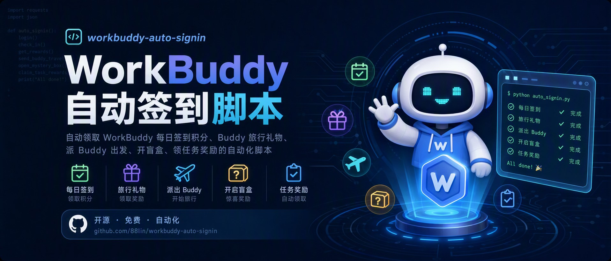
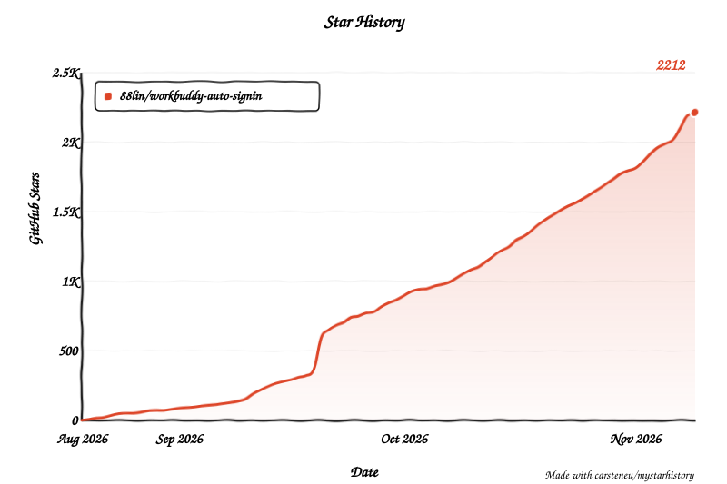

<div align="center">



# 🤖 workbuddy-auto-signin

**每天自动领取 WorkBuddy 签到积分 + Qoder CN 每日 100 Credits 的小脚本**

[](https://github.com/88lin/workbuddy-auto-signin/releases)
[](LICENSE)
[]()
[](https://github.com/88lin/workbuddy-auto-signin/stargazers)
[](https://github.com/88lin)

</div>

> 两个自包含的 Python 脚本，每天分别帮你领取 **WorkBuddy**（腾讯 AI 编程助手）的签到积分和 **Qoder CN** 的 100 通用 Credits。两者都只读取你自己机器上的登录态，零内置密钥，可安全分享。
>
> Qoder CN 是可选的独立功能，Windows 下可一键安装独立计划任务，不影响 WorkBuddy；详见[可选：Qoder CN](#qoder-cn)。
>
> 👤 作者：[88lin](https://dev.88lin.eu.org/) · 📦 仓库：[github.com/88lin/workbuddy-auto-signin](https://github.com/88lin/workbuddy-auto-signin)

> [!TIP]
> **⭐ 顺手点个 Star 再往下看**——签到接口是从桌面端逆向来的，腾讯改一版它就可能失效，修复都会第一时间推到这里。Star 一下，等哪天连签莫名其妙断了，你能一秒翻回这个仓库。

## 💖 赞助商

> 想出现在这里？联系 [bytevian@qq.com](mailto:bytevian@qq.com)

<table>
<tr>
<td width="180" align="center" valign="middle">
  <a href="https://agentrouter.org/register?aff=G5Sl"></a>
</td>
<td valign="middle"><b><a href="https://agentrouter.org/register?aff=G5Sl">Agent Router</a></b>&nbsp;是免费公益大模型API平台，支持Claude-opus-5.5、GPT-6 Astra、GPT-6.1 Sol、deepseek-v4-flash等主流模型，国内直连。注册送＄175（每日签到得＄25，被邀得＄50），支持GitHub/LinuxDo登录。</td>
</tr>
<tr>
<td width="180" align="center" valign="middle">
  <a href="https://www.sheapi.top/sign-up?aff=MvcR"></a>
</td>
<td valign="middle"><b><a href="https://www.sheapi.top/sign-up?aff=MvcR">SheApi</a></b>&nbsp;是一家可靠高效的 API 中转服务提供商，主要提供 GPT-6 Astra、kimi-k3、grok-4.7、glm-5.3、deepseek-v4.1-flash 等主流模型的高稳定中转能力，Codex 倍率补贴低至 0.06，GPT-Image-2生图每张0.04。受邀注册送$1 体验金，每日签到还可领取专属免费额度。</td>
</tr>
</table>

## ✨ 特性

| | 特性 |
|:---:|---|
| ✨ | **无需额外安装依赖** —— Python 标准库 + 本机 WorkBuddy 自带运行时，不用 `pip install` 或另装 Node；明文凭据只用 Python |
| 📦 | **单文件** —— 完全自包含 |
| ♻️ | **幂等安全** —— 先查状态，未签才领；重复运行不会多领 |
| 🐱 | **成长中心** —— 自动领旅行礼物、派 Buddy、领取新任务、领任务奖、断登自动补登、连登奖励兑换、开盲盒抽奖、能量开 Buddy 盲盒 |
| 🐾 | **成长中心轮询** —— 定时方案自带（Win 一键安装 / macOS 模板）：Buddy 一回来就领礼物并补派，把每日名额用满，不让礼物压到第二天 |
| ⏰ | **双定时模式** —— AI 自动化（跨平台）或系统级静默（Win / macOS，零 token） |
| 👥 | **多账号** —— 绑定多个账号后，一个账号跑完自动切下一个；任一账号失败不影响其余账号 |
| 📣 | **智能汇报** —— 一行 JSON，如 `成功领取 100 积分（连续 7 天，累计 700 积分）` |
| 💪 | **健壮** —— 兼容明文与受支持的加密凭据，区分格式错误、认证拒绝、权限限制及非签到季 |
| 🌍 | **跨平台** —— 自动探测 Windows / macOS / Linux 凭据文件 |
| 🔐 | **无密钥** —— 仓库不含任何密钥，只读取运行者本机登录凭据 |

---

## 📋 前置条件

- ✅ 已安装并**登录过 WorkBuddy 桌面端**（登录后自动写出凭据文件，脚本靠它鉴权）；**Linux 没有**桌面端，登录过 [CodeBuddy CLI](https://www.codebuddy.cn) 即可，脚本会自动探测它的凭据
- ✅ 本机有 **Python 3**（任意版本，无需任何第三方包）
- ⬜ 可选：装了 `git` 就能直接 `clone`；没有的话去仓库页面 **Code → Download ZIP** 解压，效果一样
- 🎁 可选：想顺便自动领 **Qoder CN** 的每日 100 Credits，需已登录 Qoder CN 桌面端；见[可选：Qoder CN](#qoder-cn)

---

## ⏰ 每日定时自动化

本脚本依赖本机桌面端的登录态，因此定时必须跑在本机。提供**两种定时模式**，按需选择：

### 模式对比

| 对比项 | 模式 A：AI 自动化 | 模式 B：系统级静默 ⭐ |
|:---:|---|---|
| **平台** | 🌐 Win / macOS / Linux | 🪟 Win / 🍎 macOS |
| **原理** | WorkBuddy 自动化触发 → AI 模型跑脚本 → 模型汇报 | 系统定时器（Win 任务计划程序 / macOS launchd）直接跑脚本 → 写日志文件 |
| **Token 消耗** | 每次消耗一次模型调用 | **零** |
| **聊天记录** | 每次一条 | **零** |
| **弹窗** | 无 | 无 |
| **可靠性** | 依赖模型可用性 | 纯系统级，更可靠 |
| **日志** | 在聊天记录里 | 独立日志文件（Win `signin.log` / macOS `/tmp/*.out`） |
| **关机错过** | 错过就错过 | 可设「错过后下次启动时补跑」 |
| **设置难度** | 中（clone + 填绝对路径 + 建自动化） | Win 低（一条命令，全自动）／ macOS 中（改模板里的绝对路径） |

### 模式 A：AI 自动化（跨平台）

适合 macOS / Linux，或不想碰任务计划程序的人。由 WorkBuddy 的自动化定时触发，AI 模型跑一次脚本再汇报——**每次会消耗一次模型调用**。

**第 1 步 · 拿到脚本**

```bash
git clone https://github.com/88lin/workbuddy-auto-signin.git
cd workbuddy-auto-signin
```

记下 `signin.py` 的绝对路径，第 2 步要用，例如：

- macOS / Linux：`/Users/you/workbuddy-auto-signin/signin.py`
- Windows：`C:\Users\you\workbuddy-auto-signin\signin.py`

**第 2 步 · 新建自动化**

- **名称**：每日自动领 WorkBuddy 积分
- **计划**：每天 00:05
- **提示词**（自动化**每次触发时执行**的那一句）：

  ```text
  运行 <python> <signin.py 的绝对路径> auto，
  把命令输出的 JSON 里 report 字段的内容，直接一句话汇报给我。
  若 JSON 的 needs_attention 为 true 或命令退出码非 0，额外提醒我处理。
  ```

> [!NOTE]
> `<python>` 填你机器上的 Python 3 命令名：macOS / Linux 通常是 `python3`，Windows 通常是 `python`。拿不准就各跑一次 `python3 --version`、`python --version`，哪个有输出用哪个。

> [!TIP]
> **懒人一键**：上面两步都能省——直接把仓库链接丢给 WorkBuddy：
> `帮我把这个仓库跑起来并设置每天 00:05 自动签到：https://github.com/88lin/workbuddy-auto-signin`
> 它会自己 `clone`、建好自动化、把绝对路径和 Python 命令名一并填好。（这条是**一次性**的设置指令，和上面那条「每次触发时执行」的提示词不是一回事。）

**想要成长中心轮询？** 再建一条自动化即可：计划设为「每 4 小时」，提示词照抄上面那句（**仍然用 `auto`**）。它会先查签到状态、未签才补，再跑成长中心——所以这条轮询顺带兜住了「00:05 没跑成」的情况；已签过时只是一个查询请求，不会重复领取。

> [!NOTE]
> 模式 A 每次运行会消耗一次 AI 模型调用并产生一条聊天记录。签到逻辑本身是确定性代码，模型仅负责「跑命令 + 汇报」。

---

### 模式 B：系统级静默（推荐）

用系统自带的定时器直接运行脚本，**完全不经过 AI 模型**。Windows 走任务计划程序 + `pythonw.exe`（无窗口 Python），macOS 走 launchd，两边都是零 Token、无窗口。

**第 1 步 · 拿到脚本**（两个系统通用；本地已有仓库就跳过）

```bash
git clone https://github.com/88lin/workbuddy-auto-signin.git
cd workbuddy-auto-signin
```

拿到脚本后，按自己的系统往下看即可——**Windows 看下面这节，macOS 直接跳到再下面那节**。

#### 🪟 Windows · 任务计划程序

**第 2 步 · 一键设置**（在仓库目录下运行，`pythonw.exe`、`signin.py` 全都自动探测）：

```powershell
powershell -ExecutionPolicy Bypass -File .\install-windows.ps1
```

它会自动建好两个任务：

| 任务 | 频率 | 干什么 |
|---|---|---|
| `WorkBuddyAutoSignin` | 每天 00:05 | 签到 + 成长中心，静默写 `signin.log` |
| `WorkBuddyGrowthPoll` | 每 4 小时 | 补签（未签才签）+ 成长中心全套 |

两个任务都零 Token、无窗口、关机错过后下次开机自动补跑。装完后终端会打印结果和下次运行时间。

脚本仅在两个任务注册成功、且都能读取到任务和运行信息后显示「完成 / 两个定时任务已就位」。任一步失败都会报告出错阶段和任务名，并以退出码 `1` 结束；若已有部分任务注册成功，会列出并保留，解决问题后重跑即可更新同名任务。

> [!TIP]
> **注册时提示「拒绝访问 / 0x80070005」？** 使用登录 WorkBuddy 的**同一 Windows 账号**，以管理员身份打开 PowerShell，进入仓库目录后重跑安装命令。提权只用于安装，定时任务仍以该账号的普通权限运行。若设备策略禁止注册任务，请联系管理员，或使用上面的「模式 A：AI 自动化（跨平台）」；模式 A 无需 Windows 计划任务，但每次会消耗一次模型调用。

> [!NOTE]
> **为什么要两个任务**：签到一天一次就够了，成长中心却不是——Buddy 出去旅行 1~4 小时就带着礼物回来，礼物得手动领。只靠 00:05 那一次，礼物会压到第二天才到账；万一某天没跑成（关机），当天唯一的派出名额还会整个浪费掉。
>
> **轮询也会补签**：00:05 那次万一撞上关机、睡眠，或者刚开机网络还没就绪，当天就再也没有第二次机会、连签直接断。所以每次轮询都会先查一次签到状态，**未签才补**——已签的情况下只是一个查询请求，代价可以忽略，换来的是一天七次机会。接口幂等，不会重复领取。

> [!TIP]
> 探测不到 Python 时脚本会提示你手动填：编辑 `install-windows.ps1`，把顶部的 `$ManualPythonw` 改成 `pythonw.exe` 的完整路径即可（`$ManualSignin` 同理，一般不用动）。任意 Python 3 自带的 `pythonw.exe` 都行，不限于系统 Python。

**卸载**：

```powershell
Unregister-ScheduledTask -TaskName "WorkBuddyAutoSignin" -Confirm:$false
Unregister-ScheduledTask -TaskName "WorkBuddyGrowthPoll" -Confirm:$false
```

只要签到、不想要成长中心轮询的话，只删第二个就行。

**查看日志**：

```powershell
Get-Content signin.log -Tail 5   # 或用记事本打开
```

日志格式（每行一条 JSON）：

```text
[2026-08-30 10:34:04] {"result": "ALREADY", "report": "今日已签过（今日 +100，连续 16 天，累计 1600 积分）", ...}
```

> [!TIP]
> **懒人一键**：直接把仓库链接发给 WorkBuddy，让它帮你装好——
> `帮我 clone 这个仓库并运行 install-windows.ps1 完成自动签到设置：https://github.com/88lin/workbuddy-auto-signin`

> [!NOTE]
> Windows 侧用的是 `silent` / `silent-poll` 参数：结果写入 `signin.log` 而非 stdout，配合 `pythonw.exe`（无控制台窗口）实现完全静默。日志文件路径可用环境变量 `WORKBUDDY_SIGNIN_LOG` 覆盖。
>
> 轮询任务一天要跑好几轮，所以**只有真领到东西或出错时才写日志**；「已签过」「Buddy 还在路上」「今日名额已用完」这类空跑不落盘，免得有价值的记录被淹没。想逐轮查看就设 `WORKBUDDY_GROWTH_LOG_EMPTY=1`。

#### 🍎 macOS · launchd

**第 2 步 · 套用模板**——随仓库提供的 `workbuddy-auto-signin.plist.example`，改掉里面的占位路径就能用：

```bash
which python3                                    # 记下输出，编辑模板时要填
mkdir -p ~/Library/LaunchAgents                  # 首次使用时该目录可能不存在
cp workbuddy-auto-signin.plist.example ~/Library/LaunchAgents/workbuddy-auto-signin.plist
# 编辑该文件：把两处 /PATH/TO/workbuddy-auto-signin 改成脚本目录的绝对路径；
# 若 which python3 的输出不是 /usr/bin/python3，把 ProgramArguments 第一项也一并换掉。然后加载：
launchctl bootout gui/$(id -u)/workbuddy-auto-signin 2>/dev/null
launchctl bootstrap gui/$(id -u) ~/Library/LaunchAgents/workbuddy-auto-signin.plist
```

**查看日志**：正常输出在 `/tmp/workbuddy-auto-signin.out`；跑不起来时先看 `/tmp/workbuddy-auto-signin.err`（Python 报错、权限拒绝都在那儿）。

**卸载**：`launchctl bootout gui/$(id -u)/workbuddy-auto-signin`

> [!TIP]
> **懒人一键**：直接把仓库链接发给 WorkBuddy，让它帮你装好——
> `帮我 clone 这个仓库，并按 workbuddy-auto-signin.plist.example 配好 macOS launchd 定时任务：https://github.com/88lin/workbuddy-auto-signin`

> [!WARNING]
> macOS 上有两个坑，踩中都是「任务静默失败、日志空空如也」：
>
> 1. **别想当然地填 `/usr/bin/python3`**——没装 Xcode Command Line Tools 时它只是个占位壳子，命令行里跑会弹安装框，**launchd 里跑则是直接失败**，错误只进 `.err` 文件。Homebrew 装的通常在 `/opt/homebrew/bin/python3`，一律以 `which python3` 的实际输出为准。
> 2. **脚本不要放在 `~/Documents`、`~/Desktop`、`~/Downloads` 下**——macOS 的隐私保护（TCC）会拦截后台进程读取这些目录，报 `Operation not permitted`。推荐放 `~/Library/Application Support/` 或任意普通目录。

> [!NOTE]
> 模板内置三种触发：每天 00:05、每 4 小时、登录时各跑一次。三者跑的都是完整的 `auto`（签到 + 成长中心），所以「每 4 小时」那轮既做成长中心轮询，也顺带兜住「00:05 没开机」的情况。脚本幂等，重复触发不会重复领取。
>
> 日志由 launchd 重定向而来，`auto` 模式**每轮都会追加一行**（不像 Windows 的 `silent-poll` 会跳过空跑），且 launchd 不做轮转。介意体积就定期清空，或把模板里的 `StandardOutPath` 指到你自己管理的路径。

#### 🔁 成长中心轮询说明（两个系统通用）

> [!IMPORTANT]
> **Buddy 旅行有每日名额限制**（服务端返回 `daily_limit_reached`），实测一天只能派出一次。轮询的作用是「及时把礼物领回来 + 补上当天错过的那次派出」，**不是**让你一天刷好几趟——脚本读到名额已用完会直接收手，不会去撞那堵墙。
>
> **先领礼物和任务奖励，再开 Buddy，最后派出旅行**。开 Buddy 可能覆盖旅行记录，因此仍在旅行、礼物未领成功或状态不明时会跳过开盒；确认空闲后先使用本轮积累的能量，再派出，每天只运行一次也能兼顾两者。派出时，尚未领养 Buddy 的已知业务拒绝只记为跳过，其他 401 / 403 仍会提醒。
>
> 轮询同时兼任**签到兜底**：每轮先查一次签到状态，未签就补上（两个系统都是如此，Windows 的 `silent-poll` 与 macOS 的 `auto` 行为一致）。所以「00:05 没跑成」不再等于「这天断签」。

---

## 🛠️ 手动运行（调试用）

想先手动跑一次、确认脚本可用：

```bash
git clone https://github.com/88lin/workbuddy-auto-signin.git
cd workbuddy-auto-signin
python signin.py auto
```

看到 `今日已签过` 或 `成功领取 N 积分`，就说明跑通了。

> [!NOTE]
> 下文所有命令都以 `python` 为例。macOS / Linux 上若提示 `command not found`，把 `python` 换成 `python3` 即可。

<details>
<summary>📖 全部命令</summary>

```bash
python signin.py auto           # 签到 + 成长中心（礼物 / 任务 / 补登 / 连登兑换 / 抽奖 / Buddy）
python signin.py silent         # 同 auto，但输出写入日志文件而非 stdout（配合定时任务静默运行）
python signin.py growth         # 仅成长中心（不签到）
python signin.py silent-poll    # 轮询：补签（未签才签）+ 成长中心，空跑不写日志（配合模式 B 的轮询任务）
python signin.py silent-growth  # silent-poll 的旧名，行为完全相同（老计划任务仍可用）
python signin.py status         # 仅查签到状态（调试）
python signin.py doctor         # 离线检查凭据格式及运行时能力，不解密、不联网
python signin.py claim          # 仅领取签到（调试，幂等）
python signin.py all            # 查签到状态 + 领取（调试）

# 多账号（详见下面「多账号」一节）
python signin.py bind <账号名>              # 把客户端当前登录的账号绑定为这个名字
python signin.py accounts                   # 查看已绑定账号
python signin.py use <账号名>               # 切换当前账号（单账号命令默认用它）
python signin.py unbind <账号名>            # 解绑并删除该账号的凭据副本
python signin.py auto --account <账号名>    # 只跑指定账号
python signin.py auto --account current     # 只跑客户端当前登录账号，忽略已绑定账号
```

</details>

---

## 👥 多账号

> [!NOTE]
> WorkBuddy 桌面端同一时刻只保存一个账号的登录状态，切换账号要重新登录。所以「多账号」由脚本自己实现：`bind` 把当时的登录凭据**原样复制**一份存到脚本目录的 `accounts/` 下，之后每次运行按这份快照去请求，不需要在客户端里来回切登录。快照保留源文件格式：加密信封原样保存，旧版明文凭据也会原样复制；运行时解密得到的明文不落盘。

### 绑定账号

每登录一个账号，绑定一次：

```bash
# 1. 在桌面端登录账号 A
python signin.py bind work

# 2. 在桌面端退出登录、换成账号 B 登录
python signin.py bind home

# 3. 确认结果（uid 只显示前 8 位，方便区分即可）
python signin.py accounts
```

输出类似：

```
已绑定 2 个账号：work（当前），home
```

`bind` 的规则：

| 场景 | 行为 |
|---|---|
| 账号名重复 | 拒绝，加 `--force` 才覆盖（重新登录后更新凭据就用它） |
| 同一个登录身份绑成两个名字 | 拒绝，加 `--force` 才能重复绑定（轮转时同 uid 只跑一次，不浪费预算） |
| 账号名 | 中英文、数字、`.`、`_`、`-`，1–32 字符，不能以符号开头；`current` / `client` 是保留名（`--account` 选择器已占用） |
| 与已有账号只差大小写 | 拒绝，加 `--force` 才能同时保留（Windows 文件名不区分大小写，容易混淆） |
| 凭据不合法（不是 JSON / 没有 accessToken / 没有 uid） | 直接拒绝，不写入半份快照 |
| 想绑定已保存的凭据文件 | `python signin.py bind <名字> --from <凭据文件>` |

每次绑定都会生成独立版本的快照，清单更新成功后才清理旧版本。清单提交失败时，原有绑定和凭据保持不变。执行前会核对快照 UID 与清单中的绑定身份；不匹配时返回 `AUTH_ERROR` / `UID_MISMATCH`，不会使用这份凭据发请求。运行期间重新绑定同名账号，旧请求的结果也不会写进新绑定。

`--account` 和 `--from` 显式传入空值会报参数错误，不会改为运行全部账号或使用客户端凭据。

本地过期预判只适用于绑定快照。未绑定账号、`--account current/client` 以及清单损坏时回退到客户端的路径，继续由服务端判断当前登录凭据是否有效。

### 切换与轮转

绑定之后**不需要改定时任务**：`auto` / `silent` / `growth` / `silent-poll` / `silent-growth` 会自动按顺序跑完全部账号，一个账号结束再切下一个。

- **顺序**：按登录身份最近一次运行时间从早到晚，没跑过的身份优先（其中当前身份排最前）；同 UID 的多份快照合并计算最近运行时间，时间并列时保留清单中的身份顺序。被 `DEFERRED` 的身份这一轮没有更新时间，下一轮优先补跑。
- **互不影响**：某个账号凭据过期、被服务端拒绝、甚至脚本内部异常，都只记在该账号名下，其余账号照常继续。整轮退出码在**任一账号失败**时为非 0，方便计划任务提醒。
- **时间预算**：整轮共用一个预算（签到类命令默认 420 秒、轮询默认 180 秒，可用 `WORKBUDDY_BUDGET_SECONDS` 调大，上限见「配置」），按「剩余时间 ÷ 剩余账号数」分配，已启动的账号至少取得 30 秒。多账号时默认预算会按每个身份 30 秒适度增加，但仍受命令上限限制；总剩余时间不足 30 秒时，其余账号记 `DEFERRED` 留到下一轮，**不算失败**。
- **只跑一个**：`--account <名字>`；`--account current` 表示用客户端当前登录的凭据（忽略账号清单）。
- **积分汇总**：多账号输出顶层的 `credits_gained` 是**本次新领到**的积分合计（签到实发 + 成长中心实发）；`ALREADY` 里的历史积分不计入，避免每天重复累加。

`silent` / `silent-poll` 的轮询去重不变：所有账号都「已签且成长中心无可领项」时仍然不写日志。

### 凭据过期与重新绑定

快照里的令牌和客户端登录时一样有有效期（通常接近一年）。凭据过期、或客户端重新登录后快照失效时，脚本会直接返回 `EXPIRED` / `AUTH_REJECTED`，并提示是哪个账号需要重新绑定：

```bash
# 在桌面端重新登录那个账号，然后
python signin.py bind <名字> --force
```

> [!IMPORTANT]
> `accounts/` 里的文件是本机登录凭据副本，**不要提交到 git、不要同步到网盘或分享**。脚本从不打印令牌；`accounts` 命令也只显示 uid 前 8 位。需要换位置时用 `WORKBUDDY_ACCOUNTS_DIR` 指定（例如加密盘）。

解绑时若快照被占用，脚本保留绑定并返回错误，解除占用后可重试 `unbind <名字>`。绑定或解绑已经提交、但旧文件最终清理失败时，输出会明确说明已完成的操作、残留文件路径，并设置 `needs_attention: true`、返回非零退出码；解除文件占用后按输出路径删除残留副本即可。

### 多账号命令一览

| 命令 | 作用 |
|---|---|
| `python signin.py accounts` | 列出已绑定账号、当前账号、凭据文件是否存在、过期时间、最近一次结果 |
| `python signin.py bind <名字> [--from <文件>] [--force]` | 绑定 / 更新账号 |
| `python signin.py use <名字>` | 切换当前账号（单账号命令默认用它；首次轮转时排最前） |
| `python signin.py unbind <名字>` | 解绑，并删除该账号的凭据副本 |
| `python signin.py <命令> --account <名字>` | 只跑指定账号 |
| `python signin.py <命令> --account current` | 只跑客户端当前登录账号 |

---

## ⚙️ 工作原理

登录后，WorkBuddy 桌面端写出 JSON 会话文件 `workbuddy-desktop.info`。旧版本的 `accessToken` 是明文字符串，新版本可能为 `$wbEncrypted` 字段信封。脚本先校验格式；受支持的 `sym-v1 / suite 1` 信封由本机客户端自带的运行时在隐藏子进程中解密，只通过内存管道返回 access token。脚本不处理 refresh token，登录及续期仍由客户端负责。

| 凭据来源 | 支持情况 |
|---|---|
| Windows / macOS 旧明文、Linux CodeBuddy CLI 明文 | 保留原路径，无需客户端解密运行时 |
| Windows 新版字段加密 | 支持 `sym-v1 / suite 1`；5.6.2、5.7.3、5.8.3 已进行本机解密与只读认证验证，其他版本按格式与运行时能力检测 |
| macOS 新版字段加密 | 已实现 `.app` 可执行文件发现及同一管道协议；尚待客户端实机验证 |
| 其他加密格式或不具备原生存储接口的运行时 | 明确返回 `AUTH_ERROR`，不发送无效令牌 |

客户端升级可能改变私有接口或格式。先运行 `python signin.py doctor` 检查本地能力，再运行只读的 `python signin.py status` 验证服务端认证；`doctor` 成功不表示解密或服务端认证已验证。

Windows 按 `WORKBUDDY_EXE → 默认安装目录 → 注册表` 的顺序发现客户端。只有默认目录找不到时，才读取当前用户和本机的 32/64 位卸载注册条目，支持自定义安装目录、带空格或逗号的路径。注册表权限不足或条目失效会跳过；未登记的安装仍可用 `WORKBUDDY_EXE` 指定路径。注册表探测只读取信息，不修改注册表，也不执行卸载命令。

签到流程：

1. 📂 **定位**凭据文件（自动探测，或用 `WORKBUDDY_AUTH_FILE` 覆盖）
2. 🔍 **查询** `POST /v2/billing/meter/checkin-activity-status` —— 今天是否已领？
3. 🎁 **领取** 若未领，`POST /v2/billing/meter/daily-checkin`
4. 🐱 **成长中心** 领旅行礼物 → 派 Buddy → 领取新任务（进度从领取才开始计）→ 领任务奖 → 断登自动补登（有补登卡时，每轮最多补一天）→ 连登奖励兑换 → 开盲盒 → 能量开 Buddy 盲盒
5. 📤 **输出** 一行 JSON，`report` 字段是人话汇报

补登只从服务端活跃日历中选择**当月、今天之前、活动上线之后且活跃分数为零**的日期，优先补最近的断点，每轮最多用一张卡。`makeup_dates` 是**已补登记录**，这些日期会被排除；日历缺失或格式异常时停止补登并提醒，不推测缺失日期的状态。规则与验证依据见[补登兼容说明](docs/plans/makeup-compatibility.md)。

> [!NOTE]
> 查询请求按网络错误或服务端 5xx 退避重试，次数受时间预算限制；补登、抽奖、领奖等写操作**不**重试，避免超时发生在服务端处理完成之后造成重复提交。两个签到接口例外——状态查询是只读的，领取接口本身幂等（当天重复领取只会返回「已签」，不会再发一次积分），故允许重试。整个运行受时间预算约束，详见「配置」。
>
> 所有请求都打到官方客户端用的同一个 endpoint（`https://copilot.tencent.com`）。签到接口系从桌面端 `app.asar` 逆向得到，仅供个人自动化使用。

---

## 🔧 配置

| 环境变量 | 作用 |
|---|---|
| `WORKBUDDY_AUTH_FILE` | 自动探测失败时，手动指定凭据文件路径 |
| `WORKBUDDY_ACCOUNTS_DIR` | 多账号清单与凭据副本的存放目录（默认脚本同目录的 `accounts/`）。目录里是本机登录凭据副本，建议放在只允许自己访问的位置 |
| `WORKBUDDY_EXE` | 指定与加密凭据对应的客户端**可执行文件**；Windows 为 `WorkBuddy.exe`，macOS 为 `.app/Contents/MacOS/` 内实际可执行文件。路径错误时直接报告，不静默回退 |
| `WORKBUDDY_SIGNIN_LOG` | `silent` 模式下日志文件路径（默认 `signin.log`） |
| `WORKBUDDY_BUDGET_SECONDS` | 单次运行的网络请求时间预算。签到类命令默认 `420`（7 分钟）、上限 `540`；`silent-poll` / `silent-growth` 轮询默认 `180`、上限 `240`。**Windows 上须为正数且小于对应计划任务的 `ExecutionTimeLimit`**（macOS launchd 无此限制）。非法值、`≤0` 或超上限都会夹到安全值，并在输出里附 `config_warning` |
| `WORKBUDDY_GROWTH_LOG_EMPTY` | 设为 `1`（或 `true`/`yes`/`on`）时，`silent-poll` 连空跑也写日志；默认只在领到东西或出错时记录 |

> [!NOTE]
> 时间预算须小于计划任务的 `ExecutionTimeLimit`。两个任务的时限不同，所以上限也分开算：签到任务 PT10M → 上限 `540`，轮询任务 PT5M → 上限 `240`，各留 60 秒给解释器启动和收尾。网络异常时单个请求最坏要耗 30 秒，若不设上限，接口逐个超时会把任务跑穿被系统强杀——而结果是在最后才写日志的，当天记录会整条丢失。预算耗尽时脚本主动收尾并如实记录，剩余项留到下次。
>
> 若你要调整某个任务的 `ExecutionTimeLimit`，须同步改 `signin.py` 顶部对应的 `MAX_BUDGET_SECONDS` / `POLL_MAX_BUDGET_SECONDS`（分别对应签到任务与轮询任务）。
>
> macOS 的 launchd **没有** `ExecutionTimeLimit` 这类外部时限，不会把跑久了的任务强杀，所以上面的上限只是 Windows 侧的约束；macOS 上脚本内置的时间预算就是唯一的兜底，保持默认即可。

---

## 🧪 排错

| 现象 | 处理 |
|---|---|
| `NO_AUTH / 未找到登录凭据` | 先登录一次 WorkBuddy 桌面端（Linux 则是 CodeBuddy CLI）；或设置 `WORKBUDDY_AUTH_FILE` |
| `NO_AUTH / WORKBUDDY_AUTH_FILE 指向的文件不存在` | 环境变量路径写错了——核对 `looked_in` 字段里的实际路径 |
| `NO_SESSION` | 本地缺少登录会话或必要字段，请先登录客户端 |
| `AUTH_ERROR / INVALID_FORMAT` | 凭据结构或令牌格式无效；先检查凭据来源和客户端版本 |
| `AUTH_ERROR / UNSUPPORTED_ENVELOPE` | 加密格式尚不支持，请更新脚本；反复重新登录不会解决格式不兼容 |
| `AUTH_ERROR / RUNTIME_NOT_FOUND` 或 `INVALID_RUNTIME_PATH` | 检查客户端安装位置，设置正确的 `WORKBUDDY_EXE` |
| `AUTH_ERROR / RUNTIME_UNAVAILABLE` 或 `HELPER_PROTOCOL` | 所选运行时不具备所需能力或返回无效结果，请检查客户端和脚本版本 |
| `AUTH_ERROR / KEY_MISMATCH` 或 `DECRYPT_FAILED` | 检查所选客户端是否与凭据匹配，以及凭据是否完整；多版本安装可用 `WORKBUDDY_EXE` 明确选择 |
| `AUTH_ERROR / HELPER_TIMEOUT` | 凭据助手超时并已停止，稍后重试或检查运行时 |
| `AUTH_REJECTED / HTTP 401` | 服务端拒绝认证；检查客户端登录状态、凭据对应的服务地址及脚本版本，不能仅凭 401 断言过期 |
| `FORBIDDEN / HTTP 403` | 服务端拒绝操作，检查账号权限或活动条件；已知“兑换档位未解锁”仍按正常业务状态处理 |
| `INACTIVE / 签到活动未开启` | 非签到季，属正常，无需处理 |
| `NETWORK / 网络不可达` | 断网或服务端不可用，**非**登录问题。脚本内置退避重试（5/15/30/60/90 秒，受时间预算约束），跨得过"刚开机网络还没就绪"那几十秒；仍失败就等下一次运行 |
| `TIMEOUT / 已达本次运行时间预算` | 网络严重超时导致预算耗尽，已领到的部分照常记录，剩余项下次再领 |
| `ERROR / 登录凭据文件不是合法 JSON` | 本地凭据文件损坏——重新登录一次 WorkBuddy 桌面端即可重建 |
| `ERROR / 脚本运行异常（...）` | 异常不会静默丢失：`silent` 模式会写进 `signin.log`；可重跑 `python signin.py status` 看原始返回 |
| 00:05 那次失败，连签却没断 | 正常——轮询任务（01/05/09/13/17/21 点）会先查状态，未签就补上。补签那轮日志会带 `"trigger": "poll"` |
| 连登兑换「进阶」未解锁（连登天数不足） | 正常——三档分别要连登满 7 / 14 / 28 天，天数不够时服务端返回 403，脚本按常态处理，不记为失败 |
| 旧日志反复出现 `date is not broken, no makeup needed` | 旧版误把已补登记录当作待补日期；更新脚本即可。新版从活跃日历选断点；查询后日期已被补上的情况按正常状态跳过 |
| 查补登日历失败 / 补登模块异常 / 补登失败 | 本轮停止补登，失败原因写入 `report`，并返回非零退出码与 `needs_attention: true`；已领取的签到积分和其他奖励仍保留 |
| `signin.log` 里查不到轮询记录 | 正常——空跑（已签过 / Buddy 还在路上 / 今日名额已用完）默认不落盘。想逐轮查看就设 `WORKBUDDY_GROWTH_LOG_EMPTY=1` |
| 轮询任务一直显示「今日旅行名额已用完」 | 服务端每日只放行一次派出，当天已派过就会这样，属正常。第二天自动恢复 |
| 调试原始返回 | `python signin.py status` 或 `python signin.py all` |
| `EXPIRED` / 多账号里某个账号 `AUTH_REJECTED` | 该账号的凭据快照已过期或被服务端拒绝：重新登录它，再 `python signin.py bind <名字> --force` |
| `DEFERRED` / 多账号提示留到下一轮 | 时间预算不够再跑一个账号，属正常保护；账号数多时调大 `WORKBUDDY_BUDGET_SECONDS`（须小于计划任务时限） |
| `MISSING` / 凭据副本丢失 | `accounts/` 里的快照被删了：重新登录该账号后 `python signin.py bind <名字> --force` |

> [!IMPORTANT]
> 需要处理的结果会附 `needs_attention: true`；静默模式也会记录认证错误。成长中心部分步骤成功不会掩盖其他步骤的硬失败，失败原因会同时进入 `report`。`status` / `claim` / `all` 请求失败返回非零退出码，`all` 的状态查询失败时不会继续领取。

---

<a id="qoder-cn"></a>

## 🎁 可选：Qoder CN 每日 100 Credits

同一个仓库还附带一个**独立**的 `qoder_signin.py`：自动领取 [Qoder CN](https://docs.qoder.cn/events/100credits) 个人用户每天 100 通用 Credits。它和 WorkBuddy 脚本、两个 WorkBuddy 定时任务互不影响，可以只装其中一个。

活动规则（以官方页面为准）：

- 每天 **10:00（UTC+8）** 刷新，每个窗口可领 **100 Credits**，领取后 **30 天**有效
- 仅限个人用户；**没有补领**，错过当天窗口就没了
- 领取接口幂等：同一窗口重复调用只返回已领取，不会多发

### 前置条件

- 已安装并**登录过 Qoder CN 桌面端**（Windows / macOS）
- 本机有 **Python 3**（与 WorkBuddy 共用即可，无第三方包）

> 自动读取登录态支持 **Windows** 与 **macOS**：
>
> - **Windows**：凭据由 DPAPI 保护，密钥从 `Local State` 解出，AES-256-GCM 解密。
> - **macOS**：密钥在登录钥匙串（`Qoder CN App Safe Storage`），凭据是 AES-128-CBC。
>   Python 标准库没有 AES，这一步交给客户端自带的 Electron 运行时（Node）完成，
>   所以同样不需要 `pip install`。
>
> Linux 暂无自动读取，可设 `QODER_TOKEN`，但令牌会过期，不推荐长期保存。

### 一键安装（Windows）

```powershell
powershell -ExecutionPolicy Bypass -File .\install-qoder-windows.ps1
```

只创建一个任务，不碰 `WorkBuddyAutoSignin` / `WorkBuddyGrowthPoll`：

| 任务 | 触发 | 干什么 |
|---|---|---|
| `QoderDailyCredits` | 每天 10:05 起，另加 11:05 / 15:05 / 19:05 / 23:05 | 查询并领取，静默写 `qoder_signin.log` |

触发时间会按活动刷新时间（UTC+8 10:00）换算成本机时间；在国内时区就是上面这几个点。五次触发是为了兜住「10:05 时活动还没下发 / 刚开机网络没就绪」；领取本身幂等，已领过只会查询，不会重复领。

> [!NOTE]
> 脚本**不会**自动使用 refresh token 续期。这样不会和桌面端争抢刷新令牌轮换，代价是登录态过期后需要你打开一次 Qoder CN 桌面端。输出里的 `token_expires_at` 是当前令牌的到期时间；`AUTH_REJECTED` 就是提醒你重新登录。

### 一键安装（macOS）

```bash
bash install-qoder-macos.sh
```

只创建一个 launchd 任务（`qoder-daily-credits`），不碰 WorkBuddy 的两个任务：

| 任务 | 触发 | 干什么 |
|---|---|---|
| `qoder-daily-credits` | 每天 10:05，另加 11:05 / 15:05 / 19:05 / 23:05 | 查询并领取，每轮一行 JSON 写入 `~/Library/Logs/QoderDailyCredits/out.log` |

安装脚本会先跑一次 `doctor` 自检（不联网、不领取），通过后才注册；注册失败会用备份自动回滚，不会把已有任务弄丢。
自检会忽略终端里的临时 `QODER_TOKEN`，确认桌面登录态可用；自定义的 `QODER_EXE` / `QODER_AUTH_DIR` 会按安装时的当前目录展开为绝对路径，用于自检并保存到后台任务。

> [!NOTE]
> macOS 上首次读取登录态时，系统可能弹出钥匙串授权框（`Qoder CN App Safe Storage`）。选「始终允许」，否则后台任务会卡在等待授权。
>
> Python 解释器优先取 `/opt/homebrew/bin/python3` 或 `/usr/local/bin/python3`（Intel 机），找不到才用 `PATH` 里的；`/usr/bin/python3` 在没有 Xcode Command Line Tools 时只是占位壳，装了 launchd 任务会静默失败。要强制指定可用 `QODER_PYTHON=/path/to/python3 bash install-qoder-macos.sh`。

### 手动运行 / 自检

```bash
python qoder_signin.py doctor          # 离线检查登录态和设备组件，不联网
python qoder_signin.py status          # 只查活动列表，不领取
python qoder_signin.py auto --dry-run  # 只报告会领到什么
python qoder_signin.py auto            # 真的领取（幂等）
```

`doctor` / `status` / `auto` 都输出一行 JSON。领取成功时 `report` 形如 `成功领取 100 Credits（act-20261013-146，领取后 30 天有效）`；本窗口已领过则是 `本周期已领取 100 Credits（...）`。

**日志**：默认写在脚本同目录的 `qoder_signin.log`。和 WorkBuddy 轮询一样，只有**真领到、活动异常或出错**才落盘；「已领过」「没有活动」不写。想连空跑也记录，设 `QODER_SIGNIN_LOG_EMPTY=1`。

**卸载**：

```powershell
Unregister-ScheduledTask -TaskName "QoderDailyCredits" -Confirm:$false
```

macOS：

```bash
bash uninstall-qoder-macos.sh
```

### 配置

| 环境变量 | 作用 |
|---|---|
| `QODER_AUTH_DIR` | 指定 Qoder CN 数据目录；Windows 默认扫描 `%APPDATA%\com.qodercn.app*`，macOS 默认扫描 `~/Library/Application Support/com.qodercn.app*` |
| `QODER_TOKEN` | 手动提供 access token（Linux 或调试用；优先于本地登录态） |
| `QODER_BASE_URL` | 覆盖 API 端点，默认 `https://openapi.qoder.com.cn` |
| `QODER_EXE` | macOS：指定 Qoder CN 可执行文件（默认 `/Applications/Qoder CN.app`） |
| `QODER_UMID_EXE` | 指定客户端自带的 `runtime-info.exe`（Windows；自动探测失败时） |
| `QODER_SIGNIN_LOG` | `silent` 模式的日志路径（默认 `qoder_signin.log`） |
| `QODER_SIGNIN_LOG_EMPTY=1` | 空跑也写日志 |

> [!TIP]
> 装完先跑一次 `python qoder_signin.py doctor` 和 `python qoder_signin.py status`：前者确认本机能解密登录态，后者确认服务端认证和活动下发正常。两者都不领取，可以放心重复执行。

> [!WARNING]
> Credits 领取接口同样是从桌面端行为推导的，服务端改一版就可能失效。脚本不含任何密钥，只读取运行者本机的 Qoder CN 登录态；不会打印 token，也不会改写登录态文件。使用风险自负，请遵守 Qoder 的服务条款。

---

## 🔐 安全与隐私

- 脚本只读取**你自己本机**的 WorkBuddy 会话文件，不含、不内嵌、不传输任何第三方密钥
- 永远不会打印 `accessToken`，`Authorization` 头不会出现在日志里
- 加密路径的密钥只在短生命周期的客户端子进程内使用；不写临时密钥文件、不缓存明文 token、不改写原凭据
- 凭据助手有独立超时及管道大小限制，受本次运行总时间预算约束；原始助手输出不进入日志
- 可安全 fork、分享、在自己机器上运行——它只作用于**你自己的**登录态

---

## ⚠️ 免责声明

> [!WARNING]
> 本项目为**非官方**工具，与腾讯或 WorkBuddy 无任何隶属关系。签到接口系从桌面端 `app.asar` 逆向得到。使用风险自负；接口可能随时变动且不另行通知。请遵守相关服务条款。

---

## 📊 Star History

<p align="center">
<a href="https://trendshift.io/repositories/196490?utm_source=trendshift-badge&utm_medium=badge&utm_campaign=badge-trendshift-196490" target="_blank" rel="noopener noreferrer"></a>
</p>

<picture>
  <source media="(prefers-color-scheme: dark)" srcset="https://raw.githubusercontent.com/88lin/workbuddy-auto-signin/star-history/assets/my-star-history/star-history-dark.svg">
  
</picture>

<div align="center">

**看到这儿了，说明这脚本大概率对你有用 —— 那就[点个 ⭐ Star](https://github.com/88lin/workbuddy-auto-signin) 吧**

一秒的事，却能在接口哪天变了、脚本悄悄失灵时，让你还找得到回来的路。

</div>

---

## 📄 协议

[MIT](LICENSE) © 2026 [88lin](https://dev.88lin.eu.org/) · 仓库：[github.com/88lin/workbuddy-auto-signin](https://github.com/88lin/workbuddy-auto-signin)
